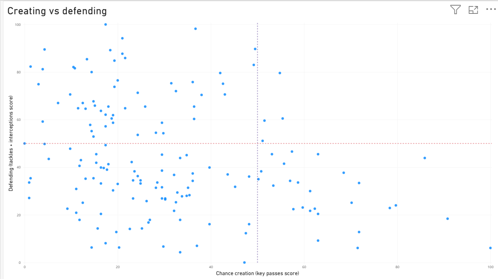
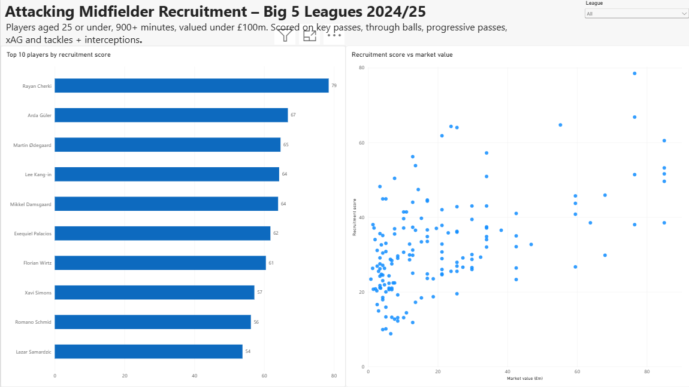
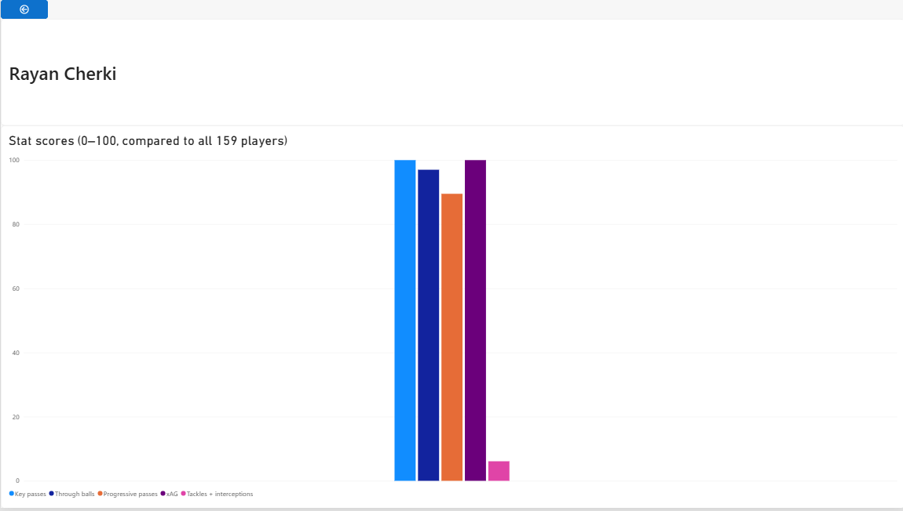
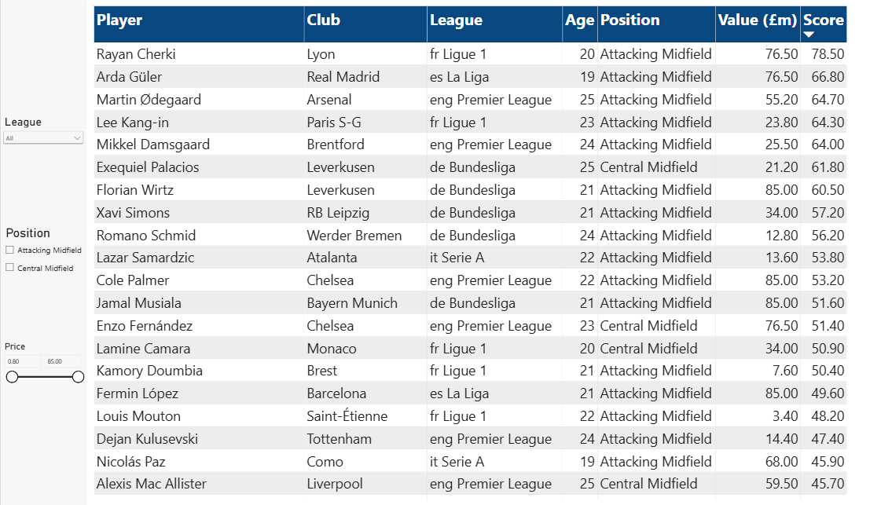

# ⚽ Football Recruitment Analysis: Finding an Attacking Midfielder

A data project that recreates part of a professional club's data-driven recruitment process: filtering, scoring and shortlisting young attacking midfielders from Europe's Big 5 leagues using real 2024/25 match data.

**Tools:** Python (pandas) · SQL (PostgreSQL / Supabase) · Power BI

**See it in action:** below is a short recording of the dashboard being used: switching between pages, using the filters and right-clicking a player to drill through to his individual stat scores.


---

## Why I built this

After reading a BBC Sport article about how Manchester City uses data in player recruitment, I wanted to try building a simplified version of that process myself, from a scouting brief through to a ranked shortlist and an interactive dashboard.

**In plain English:** football clubs need to buy new players and there are thousands to choose from. Instead of relying only on scouts watching matches, many clubs now use data to narrow the list down first. This project does exactly that: it starts with 2,700 players, applies a set of requirements, scores every player who passes and produces a shortlist.

---

## Football terms explained

You don't need to know football to follow this project. These are the terms used throughout.

**General terms**

| Term | Meaning |
|---|---|
| **Recruitment** | The process of a club finding and signing new players. |
| **Big 5 leagues** | The five strongest national leagues in Europe: England's Premier League, Spain's La Liga, Italy's Serie A, Germany's Bundesliga and France's Ligue 1. |
| **Midfielder** | A player in the middle of the pitch who links defence and attack. |
| **Attacking midfielder** | A midfielder whose main job is to create goal-scoring chances for teammates. |
| **Central midfielder** | A midfielder who does a bit of everything: helping in attack *and* in defence. |
| **Winger** | An attacking player who plays near the side of the pitch and runs forward to receive the ball. |
| **Minutes played** | How long a player was on the pitch across the season. A full match is 90 minutes, so 900 minutes is roughly 10 full matches. Setting a minimum filters out players who barely played. |
| **Per 90** | A stat divided by the minutes played, then multiplied by 90. It shows what a player does *per full match*, which lets you fairly compare someone who played 1,000 minutes with someone who played 3,000. |
| **Market value** | An estimate of how much a club would need to pay to sign the player, in £ millions. It comes from Transfermarkt, a well-known football website. It's an estimate, not a real price. |

**The five stats used to score players**

| Stat | What it means in plain English |
|---|---|
| **Key passes** | A pass that leads directly to a teammate taking a shot. It shows how often a player creates chances. |
| **Through balls** | A pass played forward into the space behind the opposing defenders, for a teammate to run onto. It's one of the hardest passes in football and often leads to big chances. |
| **Progressive passes** | A pass that moves the ball a significant distance towards the opponent's goal. It shows how well a player pushes the team forward. |
| **xAG (expected assisted goals)** | Every shot is given a probability of being scored (e.g. a shot from very close might be 0.8, a long-range shot might be 0.03). xAG adds up those probabilities for shots that came from a player's passes. It measures the **quality** of the chances a player creates, even if his teammates miss them. |
| **Tackles + interceptions** | A **tackle** is winning the ball from an opponent who has it. An **interception** is cutting out a pass meant for an opponent. Together they show how much a player helps defend. |

---

## The brief

| Requirement | Value |
|---|---|
| Position | Central attacking midfielder who also drops back to defend and plays balls for wingers to run onto |
| Age | 25 or under |
| Minutes played | 900+ (2024/25 season) |
| Budget | Under £100m |
| Leagues | Premier League, La Liga, Serie A, Bundesliga, Ligue 1 |

Players were scored on five per-90 stats, weighted to match the brief:

| Stat | What it measures | Weight |
|---|---|---|
| Key passes | Creating chances | 25% |
| Through balls | Playing runners in behind | 20% |
| Progressive passes | Moving the ball forward | 20% |
| xAG (expected assisted goals) | Quality of chances created | 15% |
| Tackles + interceptions | Defending | 20% |

---

## Method

1. **Clean** (Python): kept only the columns needed from FBref (player stats) and Transfermarkt (market values).
2. **Merge** (Python): combined players who played for two clubs into one season, calculated per-90 stats and matched players across the two sites by name and birth year. 91% of players were matched to a market value.
3. **Filter** (Python): applied the brief, cutting 2,700 players down to **159**.
4. **Score** (SQL): put each stat on a 0–100 scale using **min-max scaling**, then applied the weights to get one score out of 100.
5. **Visualise** (Power BI): built a 4-page interactive dashboard.

### How the score works

**Step 1: turn each stat into a score out of 100.** For each stat, the best player in the list gets 100, the worst gets 0 and everyone else lands in between depending on where they sit. This is needed because the stats are on very different scales: progressive passes go up to about 10 per match, but xAG only reaches about 0.5. Without this step, the stats with bigger numbers would unfairly dominate.

**Step 2: combine the five scores using the weights.** Each score is multiplied by its weight and the results are added up. Because the weights total 100%, the final score is also out of 100.

**Worked example: Rayan Cherki**

| Stat | Score out of 100 | × Weight | = Points |
|---|---|---|---|
| Key passes | 100 | × 25% | 25.0 |
| Through balls | 97 | × 20% | 19.4 |
| Progressive passes | 89.5 | × 20% | 17.9 |
| xAG | 100 | × 15% | 15.0 |
| Tackles + interceptions | 6.1 | × 20% | 1.2 |
| **Total** | | | **78.5** |

---

## Key findings

**1. Rayan Cherki (Lyon) is the top-ranked player, but he's a pure creator.**
He scored **78.5**, nearly 12 points clear of second place, with the best key passes and xAG in the whole list. However, his defending score was only **6 out of 100**. He comes top because creating stats make up 80% of the weighting.

**2. Very few midfielders both create and defend.**
Only **4 of 159** players scored above halfway on both creating and defending: Mikkel Damsgaard, Lamine Camara, Jordan James and Joe Willock.



*Each dot is one of the 159 players. Moving right means he creates more chances. Moving up means he defends more. The dashed lines mark the halfway point (50) on each scale, splitting the chart into four groups. Players in the top-right box do both jobs well, which is exactly what the brief asks for. Only 4 players are in it. Players in the bottom-right, like Cherki, are excellent creators who don't defend much.*

**3. Mikkel Damsgaard (Brentford) is the best fit for the full brief.**
He ranks **5th overall (64.0)**, is one of only 4 players who do both jobs and is valued at **£25.5m**, around a third of Cherki's price.

**4. There's strong value below £30m.**
Lee Kang-in (£23.8m), Damsgaard (£25.5m) and Exequiel Palacios (£21.2m) all score within a few points of Martin Ødegaard (£55.2m).

**5. The original budget would have missed the top two players.**
I first set the budget at £70m. Raising it to £100m added 9 players, including **Cherki and Arda Güler (both £76.5m)**, who went on to rank 1st and 2nd. A budget filter that is too tight can hide the best options.

**6. Expensive doesn't always mean a better fit.**
Market value and score are only moderately linked (correlation **0.54**, where 1 would mean price perfectly predicts score and 0 would mean no link at all). Dominik Szoboszlai (£85m) ranks **39th of 159 (38.5)**, held back by low through balls and defending scores. Morgan Rogers (£76.5m) scores 38.0, below many players worth a fraction of the price.

**7. In the Premier League alone, Damsgaard nearly matches Ødegaard.**
Filtering to Premier League players, Ødegaard ranks 1st (64.7) and Damsgaard 2nd (64.0) at less than half the price. Cole Palmer (53.2), Enzo Fernández (51.4) and Dejan Kulusevski (47.4) complete the top 5.

**8. Ødegaard is the best ball progressor in the list.**
He has the highest progressive passes score (100) of all 159 players, but scores lower on xAG (41.7) and defending (6.1).

**9. Arda Güler is the standout teenager.**
At 19, he ranks **2nd overall (66.8)**, by far the highest score of any player aged 19 or under.

**10. Premier League midfielders scored highest on average.**
Among the main leagues, Premier League players had the highest average score (**38.4**).

**11. Most players are cheap and mid-scoring and a few stars stretch the scale.**
75 of the 159 players sit below halfway on both creating and defending. This doesn't mean they're poor: they're compared against an elite group and a handful of exceptional creators (like Cherki) push the average creation score down to just 31.

---

## Dashboard

| Page | What it shows |
|---|---|
| **Overview** | Top 10 players, score vs market value, league filter |
| **Player detail** | Right-click any player to drill through to his five stat scores |
| **Creator vs defender** | Which players create, defend, or do both |
| **All players** | Full table of all 159 players, filterable by league, position and budget |



*The main dashboard page. On the left, the 10 players who best fit the brief, ranked by their score out of 100. On the right, every player is a dot: further right means more expensive, higher up means a better fit. Dots high up and to the left are the bargains, good players who don't cost much. The dropdown in the top-right corner filters both charts by league.*



*The player detail page, shown here for Rayan Cherki. Right-clicking any player on the other pages opens this view for him. Each bar is one of the five stats, scored out of 100 compared to the other 158 players. Cherki's four tall bars show he is one of the best at creating chances, while the tiny pink bar on the right shows he rarely tackles or intercepts. That's why he's described as a "pure creator".*



*The full list of all 159 players who met the brief, ranked from best to worst score. The filters on the left let anyone narrow the list down by league, by position, or by budget using the price slider. For example, dragging the slider down to £30m instantly shows the best players a smaller club could afford.*

To explore it yourself, download `dashboard/football_recruitment.pbix` and open it in Power BI Desktop (free).

---

## Challenges and how I solved them

**1. Player names didn't match between the two data sources.**
FBref and Transfermarkt spell some names differently (e.g. *Sávio* vs *Savinho*, *Lee Kang-in* vs *Kang-in Lee*). I matched players on **name + birth year**, ignored accents and capital letters and built a list of manual name fixes for the rest.

**2. Some players had no market value.**
Three midfielders who fit the brief had blank values in the Transfermarkt dataset, so they would have been silently dropped by the budget filter. I looked up their values and filled them in within the script, so the fix is reapplied every time the code runs.

**3. Players who changed clubs mid-season appeared twice.**
I combined their rows so minutes and stats cover their whole season, not half of it.

**4. Raw stats couldn't be compared fairly.**
Progressive passes go up to ~10 per game, while xAG only reaches ~0.5. Weighting raw numbers would have let progressive passes dominate the score. I used **min-max scaling** to put every stat on a 0–100 scale first.

**5. The data didn't load cleanly into SQL.**
Column names like `Tkl+Int_p90` and `90s` aren't valid in SQL and the import failed because ages were stored as decimals (`23.0`) in a whole-number column. I exported a SQL-friendly copy with simple column names and corrected the column type.

**6. Supabase only exports 100 rows from a query.**
With 159 players, exporting the results directly would have lost data. I saved the results as a new table with `CREATE TABLE ... AS` and exported the full table instead.

**7. Accented names displayed incorrectly in Excel.**
Names like *Fermín López* showed as garbled text. The file itself was correct (UTF-8). It was a display issue, so I set the file origin to UTF-8 when loading it into Power BI.

---

## Limitations

- **One season only.** 2024/25 form may not reflect a player's long-term level.
- **Stats depend on team role.** A player asked to press or sit deeper by his manager will score differently, so a scout would still need to watch him.
- **Scores are relative.** 0–100 compares players only within this group of 159, not all footballers.
- **Market values are estimates** from Transfermarkt, not real transfer fees.

---

## Project structure

```
football-recruitment-project/
├── brief.txt              # The recruitment brief and stat weights
├── scripts/               # Python: clean, merge and filter the data
├── sql/                   # SQL: scaling and scoring query
├── clean-data/            # Cleaned and final data files
├── dashboard/             # Power BI file (.pbix)
└── Images/                # Dashboard screenshots
```

## Data sources

- **Player stats:** [FBref](https://fbref.com/en/comps/Big5/Big-5-European-Leagues-Stats), Big 5 European Leagues player tables, 2024/25
- **Market values:** Transfermarkt data via Kaggle ("Football Data from Transfermarkt", `players.csv`)

Raw data files aren't included in this repo. Download them from the sources above into a `raw-data/` folder to re-run the scripts.
